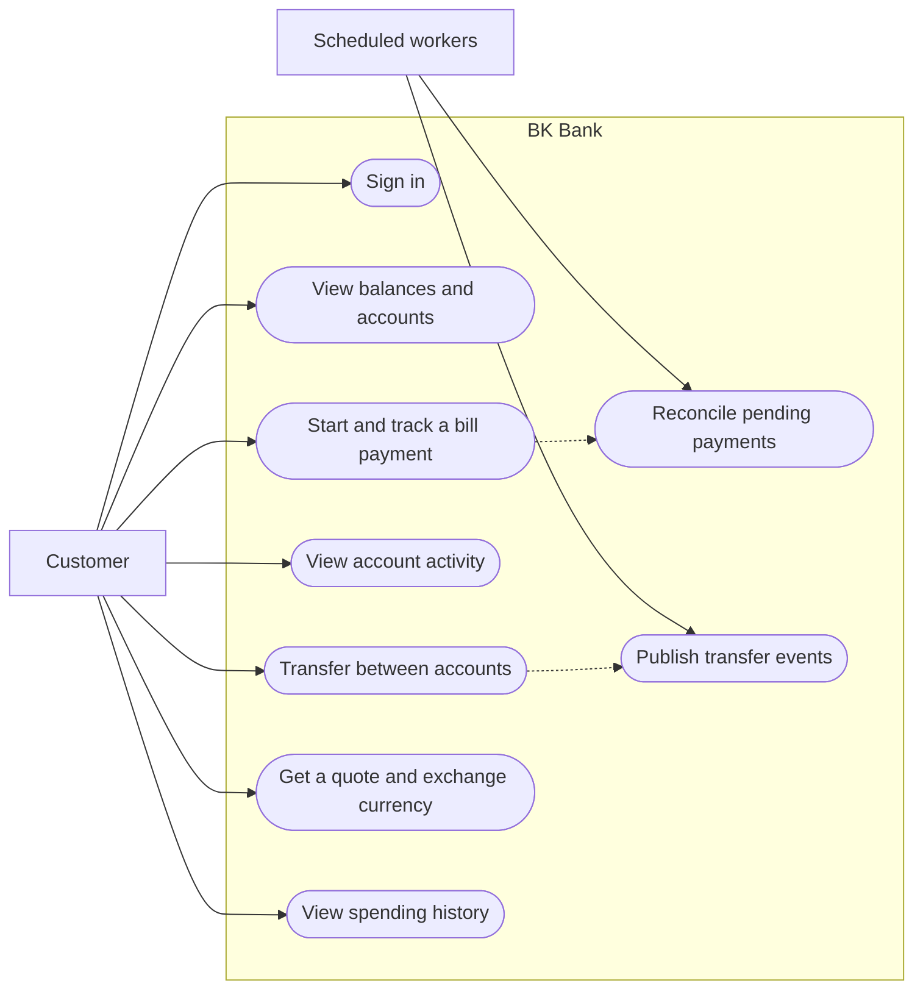
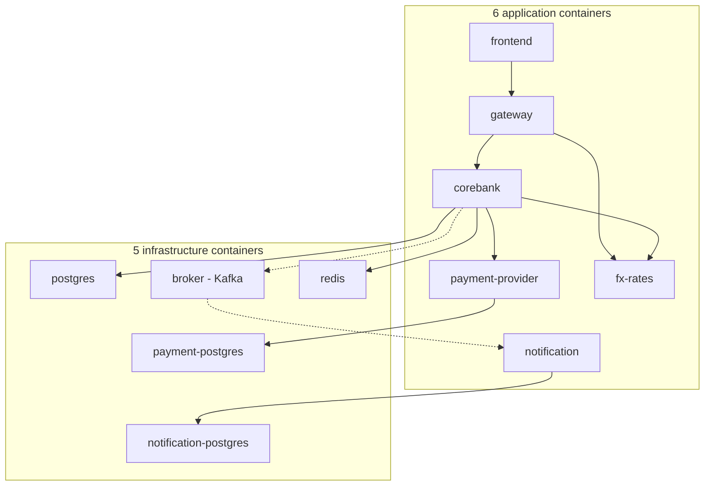

# BK Bank

**A banking platform built around reliable money movement.** BK Bank combines a Java 21/Spring Boot backend, a React interface, and separate services for payment processing, FX quotes, notifications, and API routing. Users can manage TRY, EUR, and USD accounts, make transfers, pay bills, exchange currencies, and review spending history.

The project focuses on what happens when requests are retried or infrastructure fails: concurrent transfers cannot overdraw an account, retried commands do not move money twice, uncertain payment outcomes remain reconcilable, and duplicate notifications are handled safely.

> BK Bank is a portfolio project with seeded accounts and simulated payments. It does not process real funds or customer data.

## Features

- JWT login and account ownership checks on financial resources.
- Same-currency account transfers with debit and credit ledger entries.
- Bill payments with reservation, provider approval or rejection, timeout handling, and reconciliation.
- Time-limited FX quotes and conversions between the user's currency accounts.
- A consolidated history of transfers, completed bill payments, and FX trades.
- An interface for viewing accounts, submitting transactions, and inspecting their outcomes.

## Architecture

Docker Compose starts **11 containers by default: six application containers and five infrastructure containers**. The diagram below includes every one of them. SonarQube is an optional twelfth container; Frankfurter is an external rate API, not part of Compose.

| Component | Responsibility |
| --- | --- |
| Banking core | Owns customers, accounts, balances, transfers, ledger entries, payment reservations, FX trades, security, and the outbox. |
| Payment provider | Simulates an external processor and stores its own idempotent decisions. |
| FX rates | Fetches daily reference rates, issues short-lived quotes, and validates them. |
| Notification service | Consumes Kafka events and deduplicates them with an inbox table. |
| API gateway | Routes client requests to the banking core and FX service. |
| React frontend | Presents accounts, transfers, payments, exchange, and spending history. |

The banking core is a **modular monolith** because account transfers need one transaction across balances and ledger records. Payments and notifications cross service boundaries because they own separate data and have different failure modes. Docker Compose starts the applications, three PostgreSQL databases, Kafka, and Redis in a repeatable local environment.

## Use cases

The customer works through the React application. Scheduled workers continue payments and publish notifications after the initial request has completed.



The customer authenticates first; financial endpoints check the JWT and account ownership. A payment request returns `PENDING` while the provider outcome is processed separately. A completed transfer commits its outbox event before the notification path begins.

## How services trigger each other



Between applications, solid arrows are HTTP calls. Arrows into PostgreSQL or Redis are data access; dotted arrows are asynchronous Kafka events. The banking core writes a transfer and its outbox event in one local transaction before publishing the event. The FX service also reads daily reference rates from the external Frankfurter API.

1. **Transfer:** the banking core updates balances and ledger entries, then the outbox publisher sends a Kafka event to the notification service.
2. **Bill payment:** the banking core reserves funds and returns `PENDING`. Its scheduler later calls the payment provider and reconciles the result.
3. **Currency exchange:** the gateway requests a quote from the FX service. On confirmation, the banking core validates that quote with the FX service before updating balances.

## Engineering decisions

### Atomic transfers and idempotency

`TransferService` runs inside a Spring `@Transactional` boundary. It locks both account rows with `PESSIMISTIC_WRITE` in stable UUID order, checks available funds and currency, changes both balances, writes two ledger entries, and inserts an outbox event in **one PostgreSQL transaction**. A failure rolls everything back. An `Idempotency-Key` returns the original result for a retried request and rejects conflicting reuse.

### Payment saga and uncertain outcomes

The banking core reserves funds and records a pending payment. A scheduled orchestrator calls the independent provider over HTTP with a stable payment ID. Acceptance settles the reserved amount into a clearing account and marks the payment `SUCCEEDED`; rejection releases the reservation and marks it `FAILED`. A timeout leaves the reservation intact and records `UNKNOWN` until reconciliation establishes the provider's decision. HTTP timeouts and a Resilience4j circuit breaker bound failed calls.

This saga uses synchronous provider calls and scheduled retries. Kafka carries transfer notifications; it does **not** decide payment outcomes.

### Transactional outbox and inbox

The transfer and its outbox event commit together. A publisher sends unpublished events to Kafka and marks them published after acknowledgement. A crash between those steps can resend an event, so delivery is **at least once**. The notification service deduplicates event IDs in its own database transaction. BK Bank does not claim end-to-end exactly-once delivery.

### FX conversions

The FX service obtains **daily reference mid-market rates** from Frankfurter and issues two-minute quotes. The banking core validates the quote, locks the relevant accounts, updates both balances, and records an FX trade in one local transaction. Quotes live in the FX service's memory and disappear after a restart. These are reference-rate conversions, not live market orders; no bid/ask spread or external liquidity is modeled.

## Stack and code-level techniques

| Area | Implementation |
| --- | --- |
| Backend | Java 21, Spring Boot 4, Spring MVC, Spring Data JPA/Hibernate, Bean Validation, Spring transactions. |
| Data | PostgreSQL, Flyway migrations, row locking, unique idempotency keys, ledger, outbox, and inbox tables. |
| Security | Spring Security, BCrypt password hashes, HS256 JWTs, role and account ownership checks. |
| Distributed systems | Spring Cloud Gateway, HTTP service calls, Resilience4j, Kafka, transactional outbox/inbox. |
| Operations | Docker Compose, Spring Boot Actuator health and metrics, Redis report cache, SonarQube configuration. Balances remain in PostgreSQL. |
| Frontend and tests | React 19, TypeScript, Redux Toolkit, hooks, Vite, JUnit, JaCoCo, Vitest, Testing Library. |

JPA associations use `LAZY` mapping; repository queries use `@EntityGraph` where related data is needed to avoid N+1 queries. A test compares query counts. An AOP aspect records service execution time, a request interceptor manages request IDs, and `@ControllerAdvice` standardizes API errors.

## Run locally

**Prerequisite:** Docker Desktop with a running engine. Building modules outside Docker requires JDK 21+, Maven, and Node.js 22.

```powershell
docker compose up --build -d
& .\scripts\smoke-test.ps1
```

Open [BK Bank](http://127.0.0.1:3000). The gateway listens on `http://127.0.0.1:8082`. Host ports bind to `127.0.0.1`.

**Demo login:** `bener` / `Bener123!`. The seed creates a TRY account with an opening balance of 5,000 and EUR/USD accounts. It inserts only missing records; restarting the stack does not reset balances. These credentials and Compose secrets are for local use only.

Try a transfer, payment, and exchange in the interface, or call the API:

```powershell
$login = Invoke-RestMethod -Method Post -Uri 'http://127.0.0.1:8082/api/auth/login' -ContentType 'application/json' -Body '{"username":"bener","password":"Bener123!"}'
$headers = @{ Authorization = "Bearer $($login.accessToken)"; 'Idempotency-Key' = 'readme-transfer-1' }
$body = @{ sourceAccountId = '20000000-0000-0000-0000-000000000001'; destinationAccountId = '20000000-0000-0000-0000-000000000002'; amount = 10.00 } | ConvertTo-Json
Invoke-RestMethod -Method Post -Uri 'http://127.0.0.1:8082/api/transfers' -ContentType 'application/json' -Headers $headers -Body $body
```

Replaying the same request and key returns the original transfer. A new key creates a new transfer. The smoke test writes small transactions to the persistent demo database.

## API overview

| Operation | Endpoint |
| --- | --- |
| Login | `POST /api/auth/login` |
| Accounts and ledger | `GET /api/accounts`, `GET /api/accounts/{id}`, `GET /api/accounts/{id}/ledger` |
| Transfers | `POST /api/transfers`, `GET /api/transfers/{id}` |
| Bill payments | `POST /api/bill-payments`, `GET /api/bill-payments/{id}` |
| Rates and quotes | `GET /api/fx/rates`, `POST /api/fx/quotes` |
| Exchange | `POST /api/exchanges` |
| Spending history | `GET /api/spending` |

Financial commands require a Bearer JWT; transfer, payment, and exchange commands also require an `Idempotency-Key`. Account ownership is checked against the authenticated customer's token.

## Verify

```powershell
mvn verify
mvn -f services/payment-provider/pom.xml verify
mvn -f services/notification/pom.xml verify
mvn -f services/gateway/pom.xml verify
mvn -f services/fx-rates/pom.xml verify
cd frontend
npm ci
npm run test:coverage
npm run build
```

The latest recorded run passed the Java and React checks, frontend build, and Compose smoke test. JaCoCo and Vitest enforce **100% measured line and branch coverage** for their configured source sets. Coverage is not proof that every distributed failure has been reproduced. The [engineering decisions](#engineering-decisions) section describes the relevant failure paths.

## Scope and next steps

BK Bank is intended for technical exploration rather than production banking. The opening balance is seed data, not a modeled funding transaction. The ledger currently records transfers, while FX trades have a separate audit record. Next steps include PostgreSQL concurrency tests, broker and network fault injection, durable FX quotes, complete multi-currency accounting, stronger identity and secret management, and browser end-to-end tests.

See the [architecture](#architecture), [use cases](#use-cases), and [service interactions](#how-services-trigger-each-other) above for the system's boundaries and behavior.


