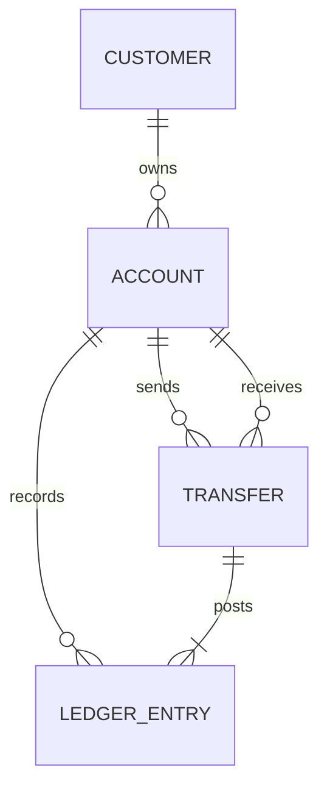

# 01 — Banka içi transferin tasarımı

## Domain modeli



- `Customer`: Müşterinin kimliği ve adı. Gerçek kişisel veri veya kimlik numarası saklanmaz.
- `Account`: TRY cinsinden hesap. `balance`, transferlerle aynı transaction'da güncellenen okuma izdüşümüdür.
- `Transfer`: Tek bir iş talebi. `idempotency_key` veritabanında unique olduğundan aynı anahtar için ikinci transfer kalıcı olamaz.
- `LedgerEntry`: Transfer başına biri `DEBIT`, biri `CREDIT` olan iki pozitif tutarlı satır. İşaret yerine yön alanı kullanılır. `balance_after` denetim için tutulur.

Banka içi transferler aynı para birimli hesaplar arasında çalışır; demo transfer ekranı TRY alıcılarını listeler. TRY, EUR ve USD hesapları sıfır bakiyeyle açılabilir. `demo` profilindeki 5.000 TRY, yalnızca örnek veri için açılış snapshot'ıdır; bunu tam bir mevduat/muhasebe akışı gibi sunmuyoruz. Döviz dönüşümü ayrı bir akıştır; [FX tasarımına](09-doviz-ve-arayuz.md) bak.

## Bir transferin sırası

1. Tutar, hesap kimlikleri ve `Idempotency-Key` doğrulanır.
2. Aynı anahtarla tamamlanmış transfer varsa isteğin hesap ve tutarı karşılaştırılır. Eşitse mevcut sonuç döner; farklıysa 409 döner.
3. İki hesap UUID sırasına göre `PESSIMISTIC_WRITE` kilidiyle okunur. Böylece A→B ve B→A istekleri ters kilit sırası yüzünden deadlock oluşturmaz.
4. Kilit beklenmiş olabileceği için idempotency anahtarı tekrar sorgulanır.
5. Gönderenin bakiyesi kontrol edilir. Yetersizse transaction geri alınır.
6. İki bakiye, transfer ve iki ledger satırı **aynı veritabanı transaction'ında** yazılır.
7. Commit başarılıysa API `COMPLETED` döner. Bir yazım başarısız olursa tüm değişiklikler rollback olur.

```mermaid
sequenceDiagram
    participant Client
    participant API
    participant DB
    Client->>API: POST /transfers + Idempotency-Key
    API->>DB: BEGIN; hesapları sabit sırayla kilitle
    API->>DB: Bakiye, transfer, DEBIT, CREDIT yaz
    DB-->>API: COMMIT
    API-->>Client: 201 COMPLETED
```

## Neden bu araçlar?

| Karar | Gerekçe |
| --- | --- |
| `BigDecimal(19,2)` | Para için kayan nokta hatasından kaçınır. Tutarın ölçeği ve pozitifliği ayrıca doğrulanır. |
| Tek `@Transactional` metot | İki hesap aynı veritabanında olduğu için ACID transaction yeterlidir. |
| Pessimistic lock | Aynı hesaptan eşzamanlı para çıkışını sıraya sokar. Kilit sırası deadlock riskini azaltır. |
| Unique idempotency key | Uygulama düzeyindeki kontrole ek olarak veritabanı düzeyinde ikinci kaydı engeller. |
| Flyway + `ddl-auto: validate` | Şemayı koddan bağımsız, sürümlü ve yeniden üretilebilir tutar. |
| `LAZY` ilişkiler | Gereksiz ilişkileri çekmez; API'de entity yerine DTO döndürülür. |

## Mülakat deneyi

İki istek aynı 1.000 TRY hesaptan 800 TRY çıkarmaya çalışır. Test, tam birinin başarılı olduğunu, toplam bakiyenin korunduğunu ve yalnızca iki ledger satırı oluştuğunu doğrular. `mvn test` ile çalıştırılır. H2 testi iş kuralını doğrular; PostgreSQL kilit semantiği için ayrıca gerçek PostgreSQL üzerinde test yapılmalıdır.

## Sonraki tasarım adımı

Mevduat/fonlama ile açılış bakiyesini tam muhasebe olayı olarak modellemek, ledger değişmezliğini veritabanında güçlendirmek, hesap hareketlerini sayfalamak ve müşteri bazlı yetkilendirme eklemek. Harici fatura ödemesi eklendiğinde ayrı veritabanı sınırı ve belirsiz yanıt durumu SAGA, Outbox ve mutabakat için gerçek ihtiyaç oluşturacak.
