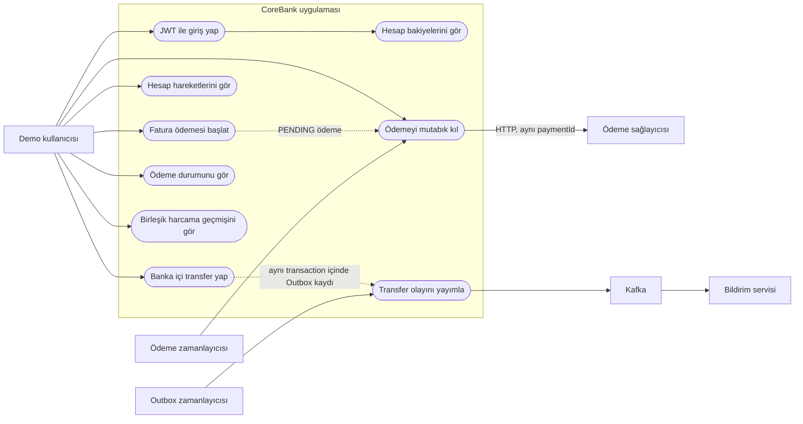
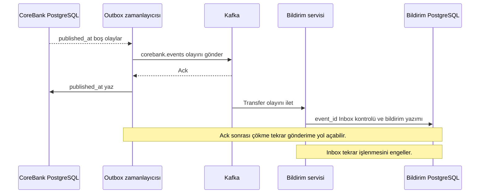

# CoreBank kullanım senaryosu ve servis akışları

Bu diyagramlar mevcut kodun davranışını gösterir. Demo kullanıcısı BCrypt parola ile giriş yapar; 30 dakikalık JWT içindeki `customer_id` bütün hesap ve işlem erişimlerinde sahiplik sınırı olarak kullanılır.

## Kullanım senaryosu diyagramı



**Sınırlar:** Kullanıcının HTTP isteği Gateway üzerinden CoreBank'e gider. Ödeme sağlayıcısını kullanıcı doğrudan çağırmaz; CoreBank zamanlayıcısı veya `POST /api/bill-payments/{id}/reconcile` onu çağırır. Kafka'ya finansal transaction içinde doğrudan publish yapılmaz; önce Outbox kaydı commit edilir.

## Banka içi transfer transaction'ı

```mermaid
sequenceDiagram
    actor Kullanici
    participant Gateway
    participant CoreBank
    participant DB as CoreBank PostgreSQL
    Kullanici->>Gateway: POST /api/transfers + Idempotency-Key
    Gateway->>CoreBank: İsteği yönlendir
    CoreBank->>DB: BEGIN; hesapları UUID sırasıyla kilitle
    CoreBank->>DB: Bakiye, transfer, DEBIT ve CREDIT yaz
    CoreBank->>DB: Outbox olayını yaz
    CoreBank->>DB: COMMIT
    CoreBank-->>Kullanici: Transfer sonucu
```

`@Transactional` sınırı CoreBank veritabanındaki finansal yazımları kapsar. Yetersiz bakiyede rollback olur; Kafka ve ödeme sağlayıcısı bu transaction'ın parçası değildir.

## Harici ödeme SAGA'sı

```mermaid
sequenceDiagram
    actor Kullanici
    participant CoreBank
    participant DB as CoreBank PostgreSQL
    participant Scheduler as SAGA zamanlayıcısı
    participant Provider as Ödeme sağlayıcısı
    participant PDB as Sağlayıcı PostgreSQL
    Kullanici->>CoreBank: POST /api/bill-payments
    CoreBank->>DB: Tutarı rezerve et; PENDING commit
    CoreBank-->>Kullanici: 202 PENDING
    Scheduler->>CoreBank: Bekleyen ödemeyi işle
    CoreBank->>Provider: HTTP POST, aynı paymentId
    Provider->>PDB: Sonucu idempotent kaydet ve commit et
    alt ACCEPTED
      Provider-->>CoreBank: ACCEPTED
      CoreBank->>DB: Rezervasyonu çöz; clearing transferi; SUCCEEDED
    else REJECTED
      Provider-->>CoreBank: REJECTED
      CoreBank->>DB: Rezervasyonu bırak; FAILED
    else Timeout veya devre kesici
      CoreBank->>DB: UNKNOWN, rezervasyon korunur
      Scheduler->>CoreBank: Sonra yeniden dene
      CoreBank->>Provider: Aynı paymentId ile tekrar POST
      Provider-->>CoreBank: Önceden kaydedilmiş sonuç
    end
```

`TIMEOUT_ONCE` örneğinde sağlayıcı kendi veritabanına commit ettikten sonra HTTP yanıtını geciktirir. CoreBank bu durumda kesin sonuç uydurmaz.

## Outbox, Kafka ve Inbox



Bu yol **en az bir kez teslimat ve idempotent tüketim** modelidir. Çoklu CoreBank replica'sı için Outbox claim mekanizması henüz eklenmemiştir.

## Kod karşılıkları

| Akış | Kod |
| --- | --- |
| HTTP girişi | `services/gateway/src/main/resources/application.yaml`, `BankController.java`, `BillPaymentController.java` |
| Tek veritabanı transferi | `TransferService.java`, `AccountRepository.java`, `LedgerEntry.java` |
| Ödeme SAGA'sı | `BillPaymentService.java`, `PaymentSagaOrchestrator.java`, `HttpPaymentGateway.java` |
| Sağlayıcı sonucu | `services/payment-provider/src/main/java/com/bener/provider/ProviderPaymentService.java` |
| Outbox/Kafka | `OutboxDeliveryService.java`, `OutboxScheduler.java` |
| Inbox/bildirim | `services/notification/src/main/java/com/bener/notification/NotificationService.java` |
