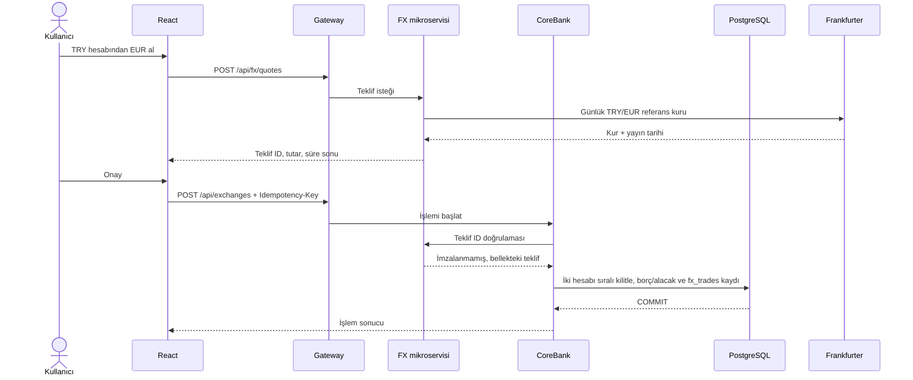

# Döviz servisi ve yeni arayüz

## Kullanıcı akışı

Panel, gönderene ait TRY/EUR/USD hesaplarını API'den listeler. Transfer ekranında aynı para birimli demo alıcılar seçilir. Ödeme ekranında tutar rezerve edilir; sağlayıcı yanıtı ve SAGA mutabakatı tabloda izlenir. Döviz ekranında kullanıcı kaynak ve hedef hesabı, tutarı seçer; önce kur teklifi alır, sonra iki dakika içinde onaylar.

FX mikroservisi kur ve geçici teklifin sahibidir. CoreBank hesapların, bakiyelerin ve `fx_trades` denetim kaydının sahibidir. Böylece iki bakiyenin değişmesi tek PostgreSQL transaction'ında gerçekleşir; iki servis arasında dağıtık bakiye transaction'ı gerekmez. Aynı `Idempotency-Key` ile tekrar istek önceki sonucu döndürür; farklı içerik 409'dur. Hesaplar sabit UUID sırasıyla kilitlenir, yetersiz bakiyede işlem geri alınır. Teklif servis belleğinde iki dakika geçerlidir; yeniden başlatmada yeni teklif gerekir.

Kur kaynağı [Frankfurter v2](https://frankfurter.dev/) günlük referans orta kurudur. Bu, gün içi işlem fiyatı değildir ve banka alış/satış makası yoktur. Arayüz Spring Security login'i ile JWT alır ve bütün CoreBank çağrılarına Bearer token ekler. Uygulama eğitim ve mülakat ortamıdır; karşı taraf likiditesi, çok para birimli genel muhasebe, tatil/gün eskiliği politikası ve üretim düzeyi teklif depolaması henüz yoktur. Sunumda bu sınırlar açıkça söylenmelidir.
