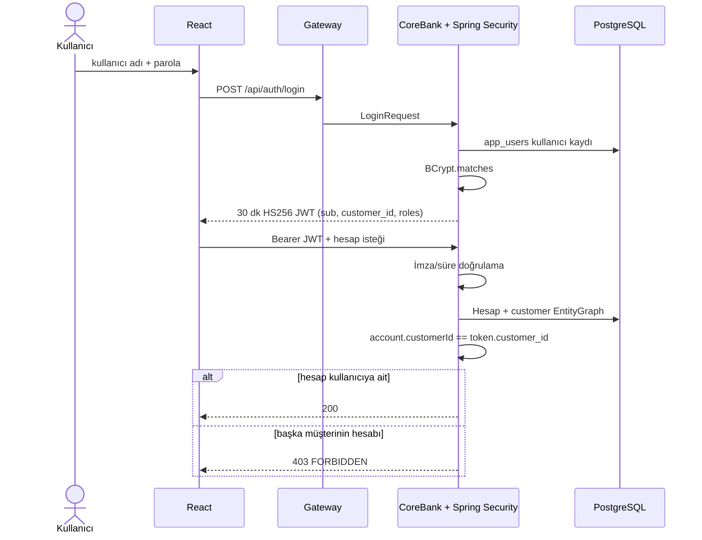

# Güvenlik ve harcama geçmişi — mülakat notu

## Neyi çözüyor?

Önceki demo, hesap UUID'sini bilen herkesin finansal uçlara erişebildiği güvenli olmayan bir yapıydı. Yeni dikey dilim kullanıcıyı doğrular, kimliğini kısa ömürlü imzalı token'a taşır ve her finansal kaynakta “bu hesap gerçekten bu kullanıcıya mı ait?” kontrolünü uygular. Kullanıcı ayrıca transfer, kesinleşmiş fatura ödemesi ve döviz alımını tek harcama görünümünde izler.

## Giriş ve yetkilendirme akışı

- Authentication: kullanıcı kimdir? `AuthService` + BCrypt + JWT.
- Authorization: neye erişebilir? `BankAuthorization` + hesap/müşteri sahipliği.
- Session: sunucuda HTTP session yok; `STATELESS`.
- Rol: `roles` claim'i `ROLE_` authority'lerine çevrilir. Müşteri oluşturma uçları `ADMIN`, finansal uçlar authenticated'dır.
- IDOR savunması: istemcinin gönderdiği UUID güvenilir sayılmaz; kaynak hesap, ödeme, transfer, rapor ve döviz işlemlerinde sahiplik yeniden kontrol edilir.

## Harcama geçmişi

`GET /api/spending` müşteri kimliğini query parametresinden almaz; doğrudan doğrulanmış JWT'den alır. SQL üç iş kaynağını birleştirir:

1. Gönderenin `DEBIT` ledger satırları → `TRANSFER`.
2. Clearing hesabına giden kesinleşmiş debit → `BILL_PAYMENT`.
3. `fx_trades.source_account_id` → `FX_EXCHANGE`.

Son 100 kayıt tarihe göre sıralanır, para birimi bazında toplam üretilir. Transfer/fatura satırının referansı ledger UUID'si değil, kullanıcıya ve operasyon ekiplerine anlamlı transfer UUID'sidir. Sorgu yalnızca kesinleşmiş muhasebe etkilerini gösterir; `PENDING`, `UNKNOWN` veya reddedilmiş ödeme harcama sayılmaz.

## DeepSeek önerisinden neyi aldık?

“Her şeyi ekle” yerine işverenin kod üzerinden sorgulayabileceği derin bir dikey dilim uygulandı: güvenli kimlik, sahiplik, gerçek SQL görünümü, SAGA/Outbox ile mevcut finansal çekirdek ve canlı smoke kanıtı. Service mesh, mTLS, Chaos Mesh ve blockchain benzeri audit zinciri yalnızca sunum etiketi olsun diye eklenmedi. Bunlar sonraki aşamada ölçülebilir gereksinim ve test senaryosuyla eklenmelidir.

## Üretime giderken sıradaki adımlar

- Keycloak/Entra/Auth0 gibi OIDC sağlayıcısı; RS256/ES256, JWKS ve anahtar rotasyonu.
- Refresh token rotasyonu, revoke/oturum politikası ve MFA.
- Gateway rate limiting, WAF ve brute-force koruması.
- Servisler arası mTLS; Kubernetes kullanılırsa service mesh değerlendirmesi.
- PII maskeleme, değiştirilemez audit event'i ve SIEM aktarımı.
- Testcontainers PostgreSQL, gerçek tarayıcı E2E ve chaos senaryoları.
